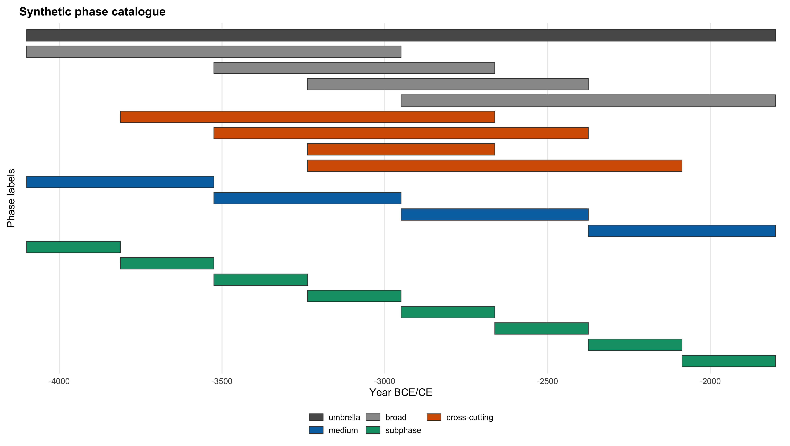
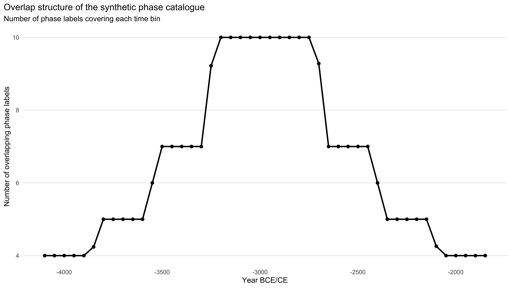
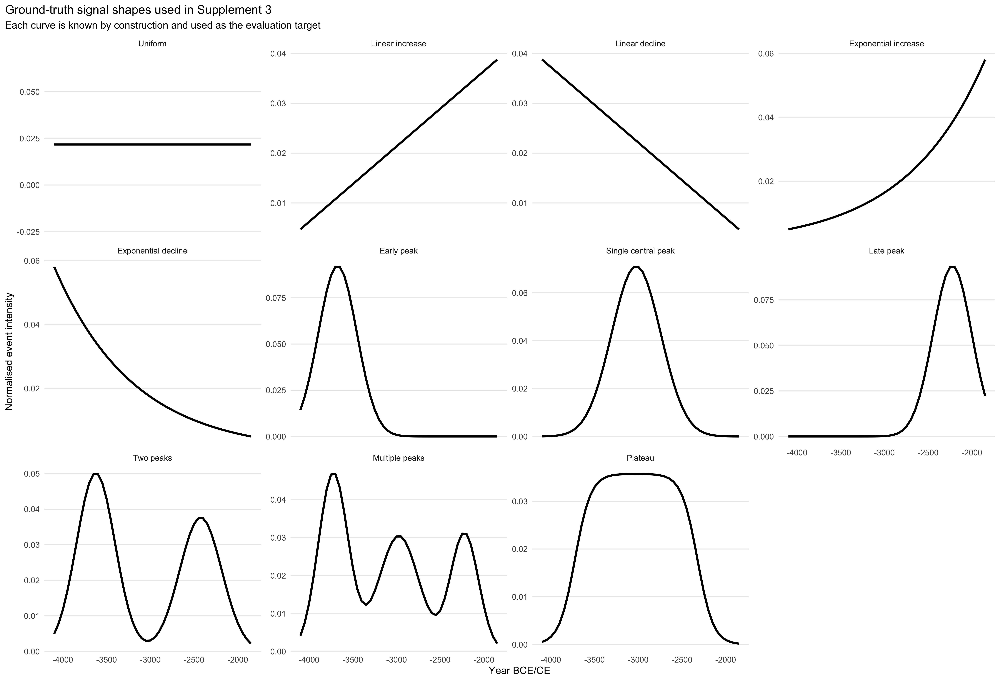
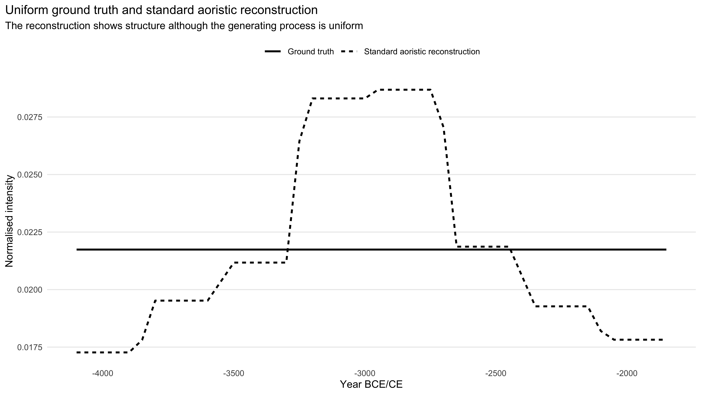
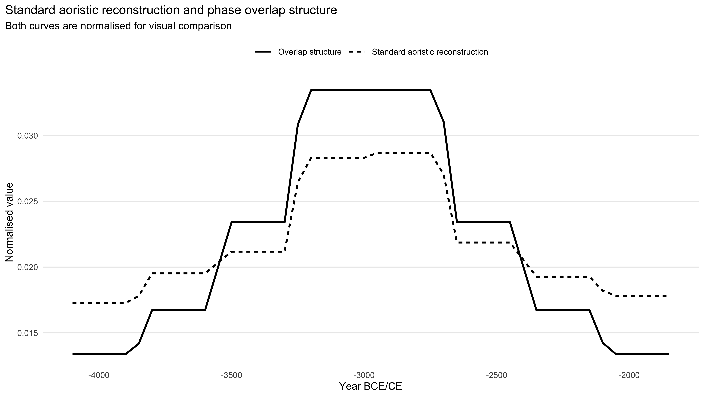
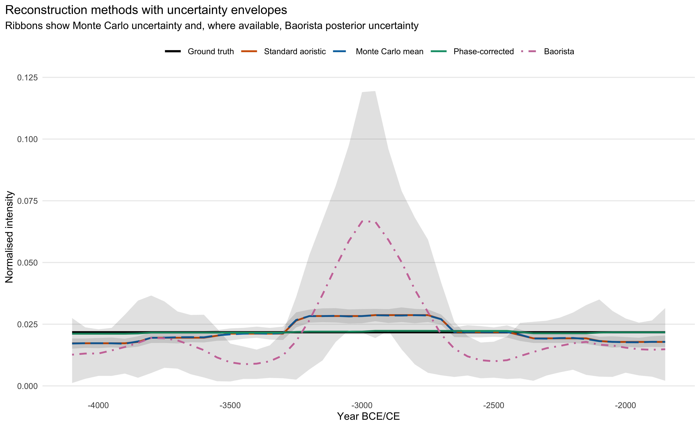
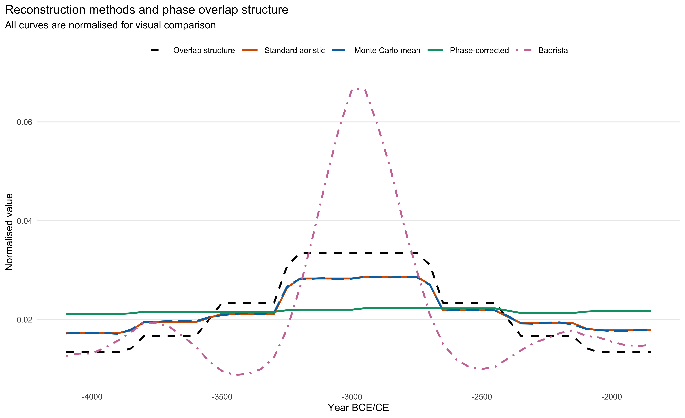
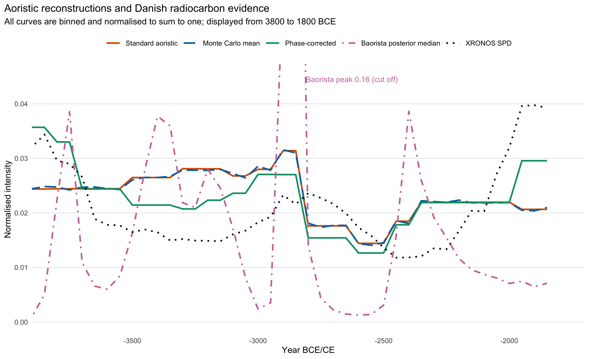
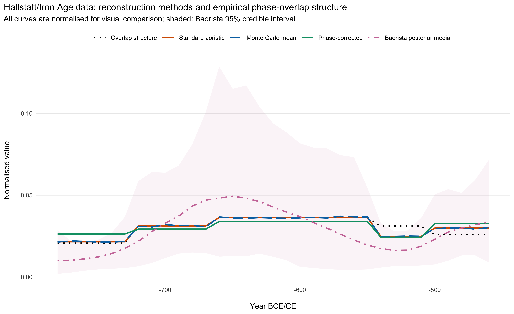

```{r setup}
library(ggplot2)
```

```{r}
#| label: s4-numbers
#| include: false

# Numbers for the Danish case study (Supplement 4)
s4_out <- function(name) {
  readr::read_csv(
    file.path("supplements", "outputs", paste0("s4_danish_neolithic_", name, ".csv")),
    show_col_types = FALSE
  )
}

fmt3 <- function(x) sub("^-", "−", formatC(x, format = "f", digits = 3))
fmt_n <- function(x) format(x, big.mark = ",", scientific = FALSE)
fmt_pct <- function(x) paste0(formatC(100 * x, format = "f", digits = 1), "%")
interval_label <- function(start, end) paste0(abs(start), "–", abs(end), " BCE")

s4_summary <- s4_out("data_summary")
s4_metric <- function(m) s4_summary$value[s4_summary$metric == m]

s4_n_records <- s4_metric("Number of records after filtering")
s4_n_unique <- s4_metric("Number of unique retained intervals")
s4_median_width <- s4_metric("Median interval width")
s4_min_width <- s4_metric("Minimum interval width")
s4_max_width <- s4_metric("Maximum interval width")

s4_top <- s4_out("interval_concentration") |>
  dplyr::arrange(rank)

s4_overlap <- s4_out("overlap_diagnostics")
s4_overlap_cor <- function(m) s4_overlap$overlap_curve_correlation[s4_overlap$method == m]

# Correlations with the SPD within the common Neolithic window (see Supplement 4).
s4_xronos_cor <- function(m) {
  r <- s4_out("xronos_robustness")
  r$correlation[r$window == "Common Neolithic window" & r$comparison == m]
}

s4_pairwise <- s4_out("pairwise_method_correlations")
s4_pair_cor <- function(a, b) {
  s4_pairwise$correlation[s4_pairwise$method_1 == a & s4_pairwise$method_2 == b]
}

s4_baorista_peak_years <- purrr::map_dbl(c(1, 10, 50, 100), function(rate) {
  post <- s4_out(paste0("baorista_rate_", rate, "_posterior_binned"))
  post$year[which.max(post$baorista_median)]
})
s4_baorista_peak <- paste0(
  abs(min(s4_baorista_peak_years)), "–", abs(max(s4_baorista_peak_years) + 50) + 1, " BCE"
)

s4_amp <- function(m) s4_overlap$overlap_relative_amplitude[s4_overlap$method == m]

s4_rob <- s4_out("xronos_robustness")
s4_rob_val <- function(window, comparison, col) {
  s4_rob[[col]][s4_rob$window == window & s4_rob$comparison == comparison]
}
fmt_p <- function(p) if (p < 0.001) "< 0.001" else formatC(p, format = "f", digits = 3)
s4_diff <- "Difference: phase-corrected minus standard"
s4_windows <- c("Common Neolithic window", "Analytical window")
s4_diff_p <- sapply(s4_windows, function(w) s4_rob_val(w, s4_diff, "p_surrogate"))

s4_dedup <- readr::read_csv("data/xronos_denmark_dedup_report.csv", show_col_types = FALSE)
s4_c14_final <- s4_dedup$after_determination_deduplication

# Supplement 1 (uniform simulation, standard reconstruction)
s1_cor <- readr::read_csv("supplements/outputs/s1_overlap_correlations.csv", show_col_types = FALSE)
s1_fit <- readr::read_csv("supplements/outputs/s1_fit_metrics.csv", show_col_types = FALSE)
s1_c <- function(pattern) s1_cor$value[grepl(pattern, s1_cor$metric)][1]
s1_f <- function(pattern) s1_fit$value[grepl(pattern, s1_fit$metric)][1]

# Supplement 6 (assignment models): share of the systematic error of the
# standard reconstruction that the correction removes
s6_exp <- readr::read_csv("supplements/outputs/s6_expected_metrics.csv", show_col_types = FALSE)
s6_u <- s6_exp[s6_exp$pattern == "uniform" & s6_exp$model != "M0_uniform", ]
s6_red <- sapply(split(s6_u, s6_u$model), function(d) {
  1 - d$rmsd[d$method == "phase_corrected"] / d$rmsd[d$method == "standard"]
})

# Supplement 6, Danish catalogue: concentration of label use.
s6_dk_use <- readr::read_csv("supplements/outputs/s6_danish_label_use.csv", show_col_types = FALSE)
s6_dk_d0_top2 <- s6_dk_use$share_top2_median[s6_dk_use$model == "D0_uniform"]
```

```{r}
#| label: s5-numbers
#| include: false

# Numbers for the Hallstatt case study (Supplement 5)
s5_out <- function(name) {
  readr::read_csv(
    file.path("supplements", "outputs", paste0("s5_hallstatt_", name, ".csv")),
    show_col_types = FALSE
  )
}

s5_summary <- s5_out("data_summary")
s5_metric <- function(m) s5_summary$value[s5_summary$metric == m]

s5_n_records <- s5_metric("Number of records after filtering")
s5_n_unique <- s5_metric("Number of unique retained intervals")
s5_median_width <- s5_metric("Median interval width")
s5_min_width <- s5_metric("Minimum interval width")
s5_max_width <- s5_metric("Maximum interval width")

s5_top <- s5_out("interval_counts") |>
  dplyr::arrange(dplyr::desc(n)) |>
  dplyr::mutate(cumulative_share = cumsum(share))

s5_overlap <- s5_out("overlap_diagnostics")
s5_overlap_cor <- function(m) s5_overlap$overlap_curve_correlation[s5_overlap$method == m]
s5_amp <- function(m) s5_overlap$overlap_relative_amplitude[s5_overlap$method == m]

s5_pairwise <- s5_out("pairwise_method_correlations")
s5_pair_cor <- function(a, b) {
  s5_pairwise$correlation[s5_pairwise$method_1 == a & s5_pairwise$method_2 == b]
}

# Supplement 6, Hallstatt catalogue: label use expected under equal choice
s6_hs_use <- readr::read_csv("supplements/outputs/s6_hallstatt_label_use.csv", show_col_types = FALSE)
s6_hs_d0_top2 <- s6_hs_use$share_top2_median[s6_hs_use$model == "D0_uniform"]
```

```{r}
#| label: s2-numbers
#| include: false

# Fit metrics of the uniform method comparison (Supplement 2).

s2_fit <- readr::read_csv("supplements/outputs/s2_fit_metrics.csv", show_col_types = FALSE)
s2_ovl <- readr::read_csv("supplements/outputs/s2_overlap_diagnostics.csv", show_col_types = FALSE)
s2_val <- function(method, col) {
  x <- if (col %in% names(s2_fit)) s2_fit[[col]][s2_fit$method == method] else s2_ovl[[col]][s2_ovl$method == method]
  x
}

# Errors in per cent of the mean bin density (fmt_rel); A_lambda via fmt_pct
n_bins <- nrow(readr::read_csv("supplements/outputs/s2_reconstruction_curves_binned.csv", show_col_types = FALSE))
fmt_rel <- function(x) paste0(formatC(100 * x * n_bins, format = "f", digits = 1), "%")
```

# Abstract

Aoristic analysis is widely used in archaeology to aggregate observations dated to typological phases instead of calendar years. The standard approach and its Monte Carlo variants spread each observation uniformly over its time interval, treating intervals as neutral containers of chronological uncertainty. We show that this assumption fails when observations are assigned to overlapping, hierarchical phase catalogues. In simulations with a uniform event process, the standard aoristic sum reproduces the overlap structure of the catalogue almost exactly, whatever the sample size, and neither Monte Carlo aoristics nor a Bayesian reconstruction removes this bias. The reason is that archaeological dates are not coarsened at random, since the label an observation receives depends on its date. From a simple model in which an event is equally likely to receive any label covering its date, we derive a phase-corrected weighting that needs no further data. It reduces the reconstruction error by about an order of magnitude and performs at least as well as the standard approach for most non-uniform signals and assignment models, although it dampens real peaks that coincide with the overlap geometry. Applied to Danish Neolithic settlement records and to Early Iron Age burials from southern Germany, it largely removes the coupling to the interval structure. It moves the Danish reconstruction towards an independent radiocarbon record and suggests that one Iron Age phase was shorter than conventionally assumed. As site databases are increasingly used for demographic inference, chronological classification has to be treated as part of the data.

# Keywords

aoristic analysis; chronological uncertainty; archaeological phases; temporal frequency analysis; coarse data

# 1. Introduction

Large datasets are increasingly used to study population dynamics, settlement intensity and long-term socio-ecological change [@kristiansen_towards_2014; @kintigh_grand_2014]. Summed probability distributions of radiocarbon dates [e.g. @birdP3k14cSyntheticGlobal2022; @hinz_radon_2012; @roeXRONOSOpenData2025] serve as proxies for past activity and population size [e.g. @hinz_demography_2012; @riede_climate_2009; @timpson_reconstructing_2014], and their sensitivity to calibration, sample selection and research history [@williams_use_2012; @contreras_summed_2014; @torfing_neolithic_2015] has led to simulation-based workflows [@martin_oxcaar:_2018; @bevan_rcarbon:_2018].

A large part of the archaeological record, however, is not directly dated. Sites, finds, graves and features are assigned to typological, cultural or chronological phases, and because radiocarbon and other absolute dates are unevenly available, such phase-dated evidence is often the only basis for large-scale temporal frequency analysis [@contreras_summed_2014; @kolar_spatio-temporal_2016]. Regional and national site databases make it available in large quantities [@palmisano_comparing_2017; @lawrence_collapse_2021; @cooper_embracing_2016]. It is usually aggregated by aoristic analysis [@ratcliffe_aoristic_1998; @ratcliffe_aoristic_2000; @mischka_aoristische_2004; @johnson_aoristic_2004], which distributes each observation uniformly over its interval and sums these probabilities, or by Monte Carlo variants that draw possible dates from the same intervals [@crema_probabilistic_2010; @crema_modelling_2012; @kolar_spatio-temporal_2016].

Aoristic analysis can be understood as implicit temporal imputation, which distributes unknown event dates over the years compatible with the chronological information. The same imputation, under other names, has long been used to quantify pottery and other artefacts dated by type [@fentress_counting_1988; @baxter_reinventing_2016]. Such imputations are sensitive to assumptions about the process that produced the coarsening [@heitjanInferenceCoarseData1990]. In archaeology this process is a classification. Phase intervals are not rounded measurements but categories of hierarchical and overlapping schemes, and whether an observation receives a narrow or a broad label depends on diagnostic artefacts, preservation, research history and the state of chronological knowledge. Standard aoristic reconstruction can therefore inherit structure from the classification system, and structurally induced peaks may be mistaken for demographic or settlement processes. Effects of periodisation on such time series have been noted before [@bevan_modifiable_2021]. Here we isolate one mechanism, the overlap of phase labels, and derive a correction for it.

The paper makes three contributions. First, we show that overlapping phase catalogues distort aoristic reconstructions systematically, because the label an observation receives depends on its true date, and that the distortion persists in Monte Carlo and Bayesian variants. Second, we derive the phase-corrected weighting implemented in our R package aoristAAR from an explicit model of label assignment. It needs no information beyond the observed intervals. Third, we test the correction in simulations and on two empirical datasets, Danish Neolithic settlements and Early Iron Age burials from southern Germany, and provide diagnostics that show whether a reconstruction is affected and whether the assumptions of the correction hold.

# 2. Conceptual background

## 2.1 Aoristic analysis and temporal uncertainty

Aoristic analysis aggregates observations that can only be assigned to a chronological interval into a temporal frequency distribution [@ratcliffe_aoristic_1998; @ratcliffe_aoristic_2000; @johnson_aoristic_2004]. Let each observation $i$ be assigned to an interval $I_i$, and let $t$ denote a discrete time unit. In the standard proportional approach, the contribution of observation $i$ to time unit $t$ is

$$
p_i(t) =
\begin{cases}
\frac{1}{|I_i|}, & \text{if } t \in I_i, \\
0, & \text{otherwise,}
\end{cases}
$$

where $|I_i|$ is the duration of the interval, and the aoristic sum is

$$
A(t) = \sum_{i=1}^{n} p_i(t).
$$

An observation with a long interval contributes a little to many time units, one with a short interval much to few. The underlying assumption, that every time unit within the assigned interval is equally likely, follows the "principle of insufficient reason" and provides a simple and explicit expectation [@cremaBayesianAlternativeAoristic2025]. Non-uniform alternatives have been proposed [@baxter_reinventing_2016] but are rarely used, and the bias discussed below does not depend on this choice.

Monte Carlo aoristics draws event dates uniformly from the assigned intervals, so that the mean of its curves converges on the standard aoristic sum. A Bayesian alternative that models the latent temporal distribution has recently been proposed [@cremaBayesianAlternativeAoristic2025] and serves here as a benchmark (Section 3.2).

## 2.2 Overlapping phase catalogues

Archaeological phase systems are often hierarchical and overlapping. A single scheme may contain broad periods, narrower phases, local subphases and cross-cutting typological categories, so that an observation may be dated to a narrow interval or to a broader one that overlaps several more specific phases. In what follows, a *label* is a category of such a scheme, its *interval* is the time span it covers, and the *catalogue* is the set of labels in use.

```{r}
#| label: toy-schematic-setup
#| include: false

dir.create("figures", showWarnings = FALSE, recursive = TRUE)

toy_cols <- c(
  phase_bg  = "grey96",
  boundary  = "grey70",
  outline   = "grey25",
  interval  = "grey35",   # observed assignments: neutral input
  standard  = "#D55E00",  # standard aoristic / overlap-induced effect
  overlap   = "#D55E00",  # overlap structure: same role as standard bias
  inverse   = "#009E73",  # inverse-overlap weights
  corrected = "#009E73"   # corrected contribution
)

theme_toy_schematic <- function(base_size = 8) {
  ggplot2::theme_minimal(base_size = base_size) +
    ggplot2::theme(
      strip.text.y = ggplot2::element_text(
        angle = 0,
        hjust = 0,
        face = "bold"
      ),
      axis.text.y = ggplot2::element_blank(),
      axis.ticks.y = ggplot2::element_blank(),
      panel.grid = ggplot2::element_blank(),
      panel.spacing.y = grid::unit(0.9, "lines"),
      plot.margin = ggplot2::margin(5.5, 8, 5.5, 5.5)
    )
}

toy_phases <- tibble::tibble(
  phase = c("A", "B", "C"),
  xmin = c(0, 1, 2),
  xmax = c(1, 2, 3),
  xmid = c(0.5, 1.5, 2.5)
)

toy_intervals <- tibble::tibble(
  observation = c("Label 1", "Label 2", "Label 3"),
  interval = c("A", "A–B", "A–B–C"),
  n = c(2, 5, 11),
  xmin = c(0, 0, 0),
  xmax = c(1, 2, 3),
  y = c(3, 2, 1),
  label = c("A: 2 observations", "A–B: 5 observations", "A–B–C: 11 observations")
)

toy_overlap <- toy_phases |>
  dplyr::mutate(
    lambda = mapply(
      function(a, b) {
        sum(toy_intervals$xmin < b & toy_intervals$xmax > a)
      },
      xmin,
      xmax
    ),
    inverse_lambda = 1 / lambda
  )

toy_standard_total <- toy_phases |>
  dplyr::mutate(
    standard_contribution = c(
      2 + 5 / 2 + 11 / 3,
      5 / 2 + 11 / 3,
      11 / 3
    ),
    contribution_label = c(
      "2 + 5/2 + 11/3",
      "5/2 + 11/3",
      "11/3"
    ),
    value_label = sprintf("%.1f", standard_contribution)
  )

toy_corrected_by_observation <- tidyr::crossing(
  toy_intervals |>
    dplyr::select(
      observation,
      interval,
      n,
      obs_xmin = xmin,
      obs_xmax = xmax
    ),
  toy_overlap |>
    dplyr::select(
      phase,
      phase_xmin = xmin,
      phase_xmax = xmax,
      xmid,
      lambda,
      inverse_lambda
    )
) |>
  dplyr::filter(
    phase_xmin >= obs_xmin,
    phase_xmax <= obs_xmax
  ) |>
  dplyr::group_by(observation, interval) |>
  dplyr::mutate(
    raw_weight = inverse_lambda,
    corrected_weight = raw_weight / sum(raw_weight)
  ) |>
  dplyr::ungroup()

toy_corrected_total <- toy_corrected_by_observation |>
  dplyr::mutate(
    xmin = phase_xmin,
    xmax = phase_xmax
  ) |>
  dplyr::group_by(phase, xmin, xmax, xmid) |>
  dplyr::summarise(
    corrected_contribution = sum(n * corrected_weight),
    .groups = "drop"
  )

make_toy_phase_background <- function(panels) {
  tidyr::expand_grid(
    panel = panels,
    toy_phases
  )
}
```

```{r}
#| label: fig-schematic-overlap-bias
#| fig-alt: "Schematic bars of nested intervals and their standard aoristic weights"
#| echo: false
#| fig-cap: "Minimal example. Grey bars show the observed assignments, orange bars the standard aoristic contribution. With six events per phase and equal choice among the labels covering each date, the labels A, A--B and A--B--C are used 2, 5 and 11 times, and the standard allocation decreases from A to C."
#| fig-width: 7.5
#| fig-height: 4.5

toy_bias_panels <- c(
  "A. Observed chronological assignments",
  "B. Standard aoristic contribution"
)

toy_phase_background_bias <- make_toy_phase_background(toy_bias_panels)

toy_intervals_plot <- toy_intervals |>
  dplyr::mutate(
    panel = "A. Observed chronological assignments"
  )

toy_standard_plot <- toy_standard_total |>
  dplyr::mutate(
    panel = "B. Standard aoristic contribution"
  )

p_schematic_overlap_bias <- ggplot2::ggplot() +
  ggplot2::geom_rect(
    data = toy_phase_background_bias,
    ggplot2::aes(
      xmin = xmin,
      xmax = xmax,
      ymin = -Inf,
      ymax = Inf
    ),
    fill = toy_cols[["phase_bg"]],
    colour = "white"
  ) +
  ggplot2::geom_vline(
    xintercept = c(0, 1, 2, 3),
    linewidth = 0.25,
    linetype = "dotted",
    colour = toy_cols[["boundary"]]
  ) +
  ggplot2::geom_rect(
    data = toy_intervals_plot,
    ggplot2::aes(
      xmin = xmin,
      xmax = xmax,
      ymin = y - 0.28,
      ymax = y + 0.28
    ),
    fill = toy_cols[["interval"]],
    colour = toy_cols[["outline"]],
    linewidth = 0.25
  ) +
  ggplot2::geom_text(
    data = toy_intervals_plot,
    ggplot2::aes(
      x = (xmin + xmax) / 2,
      y = y,
      label = label
    ),
    colour = "white",
    size = 3
  ) +
  ggplot2::geom_rect(
    data = toy_standard_plot,
    ggplot2::aes(
      xmin = xmin + 0.08,
      xmax = xmax - 0.08,
      ymin = 0,
      ymax = standard_contribution
    ),
    fill = toy_cols[["standard"]],
    colour = toy_cols[["outline"]],
    linewidth = 0.25
  ) +
  ggplot2::geom_text(
    data = toy_standard_plot,
    ggplot2::aes(
      x = xmid,
      y = standard_contribution + 0.6,
      label = contribution_label
    ),
    size = 3
  ) +
  ggplot2::geom_text(
    data = toy_standard_plot,
    ggplot2::aes(
      x = xmid,
      y = standard_contribution / 2,
      label = value_label
    ),
    colour = "white",
    size = 3
  ) +
  ggplot2::scale_x_continuous(
    breaks = toy_phases$xmid,
    labels = toy_phases$phase,
    limits = c(0, 3),
    expand = ggplot2::expansion(mult = c(0.01, 0.01))
  ) +
  ggplot2::facet_grid(
    panel ~ .,
    scales = "free_y",
    space = "fixed"
  ) +
  ggplot2::labs(
    x = "Equal-duration phases",
    y = NULL
  ) +
  theme_toy_schematic(base_size = 8)

p_schematic_overlap_bias

ggplot2::ggsave(
  "figures/schematic_overlap_bias.png",
  p_schematic_overlap_bias,
  width = 7.5,
  height = 4.5,
  dpi = 600
)
```

A minimal example illustrates the mechanism (@fig-schematic-overlap-bias). Consider three successive phases, $A$, $B$ and $C$, of equal duration, and a catalogue with only three labels, $A$, $A$–$B$ and $A$–$B$–$C$. Suppose that six events fall into each phase and that every event receives, with equal probability, one of the labels covering its date. The six events in $A$ are then shared among three labels, those in $B$ among two, and those in $C$ all receive $A$–$B$–$C$, so that the three labels are used 2, 5 and 11 times.

Under standard proportional aoristics, phase $A$ receives $2 + \frac{5}{2} + \frac{11}{3} \approx 8.2$, phase $B$ receives $\frac{5}{2} + \frac{11}{3} \approx 6.2$, and phase $C$ only $\frac{11}{3} \approx 3.7$, although all three contain the same number of events. A narrow label places all its observations in the phase it covers. A broad label, by contrast, collects its observations mainly from those parts of its interval that few other labels cover, here $A$–$B$–$C$ from phase $C$, but the standard method spreads them evenly over the whole interval. It thus shifts weight towards the parts of the sequence where many labels overlap. The problem is not chronological uncertainty as such but its structuring by the catalogue used to describe it.

## 2.3 Phase-corrected aoristic weighting

To address this mechanism, we use a phase-corrected weighting, implemented as `period_correction` in our R package aoristAAR [@hinz_aoristaar_2026]. For each time unit $t$, we first count the unique observed intervals covering it, the overlap count

$$
\lambda(t) = \sum_{j=1}^{m} \mathbf{1}(t \in J_j),
$$

where $J_1, \ldots, J_m$ are the unique observed intervals and $\mathbf{1}(\cdot)$ is the indicator function. Each observation is then distributed within its interval in proportion to the inverse of this count,

$$
p_i^{*}(t) =
\begin{cases}
\frac{\lambda(t)^{-1}}{\sum_{u \in I_i} \lambda(u)^{-1}},
& \text{if } t \in I_i, \\
0, & \text{otherwise,}
\end{cases}
$$

so that its total contribution remains one, and the corrected sum is $A^{*}(t) = \sum_{i} p_i^{*}(t)$. Years covered by many overlapping labels receive less weight within each interval, years covered by few labels more. In the example, $\lambda$ is 3, 2 and 1 for phases $A$, $B$ and $C$, and the corrected sum recovers the six events per phase exactly (@fig-schematic-phase-correction).

The weighting has a simple probabilistic interpretation. Suppose that an event dated to $t$ is attributed to any one of the $\lambda(t)$ labels covering $t$ with equal probability, $P(J_j \mid t) = \lambda(t)^{-1}$. With a flat prior on $t$, the posterior distribution of the date of an observation carrying label $J_j$ is then proportional to $\lambda(t)^{-1}$ within $J_j$, which is the phase-corrected weight $p_i^{*}(t)$. Standard proportional aoristics, by contrast, implicitly assumes that the observations are coarsened at random, i.e. that the probability of observing a particular interval does not depend on where within it the true value lies. Only under this assumption can the coarsening process be ignored in inference [@heitjanInferenceCoarseData1990]. Under the assignment model above it does not hold, because the probability of a label depends on the true date through $\lambda(t)$. This also affects likelihood-based reconstructions that treat the observed intervals as censoring bounds (Section 5.1). The phase correction follows from the simplest model of label assignment and rests on two assumptions, a flat prior within each interval and label assignment that is indifferent between all compatible labels. In applications, $\lambda(t)$ is counted over the intervals that occur in the data, so that the equivalence with the posterior is exact in expectation and approximate in any finite sample.

```{r}
#| label: fig-schematic-phase-correction
#| fig-alt: "Schematic bars of overlap counts and phase-corrected weights"
#| echo: false
#| fig-cap: "Phase-corrected weighting for the same example. Orange bars show the overlap count $\\lambda(t)$, green bars the inverse-overlap weights and the corrected contribution, which recovers the six events per phase."
#| fig-width: 7.5
#| fig-height: 5.2

toy_correction_panels <- c(
  "A. Overlap count",
  "B. Inverse-overlap weight",
  "C. Renormalised corrected contribution"
)

toy_phase_background_correction <- make_toy_phase_background(toy_correction_panels)

toy_panel_data <- dplyr::bind_rows(
  toy_overlap |>
    dplyr::transmute(
      panel = "A. Overlap count",
      role = "Overlap count",
      phase, xmin, xmax, xmid,
      value = lambda,
      label = paste0("\u03bb = ", lambda)
    ),
  toy_overlap |>
    dplyr::transmute(
      panel = "B. Inverse-overlap weight",
      role = "Inverse-overlap weight",
      phase, xmin, xmax, xmid,
      value = inverse_lambda,
      label = paste0("1/", lambda)
    ),
  toy_corrected_total |>
    dplyr::transmute(
      panel = "C. Renormalised corrected contribution",
      role = "Corrected contribution",
      phase, xmin, xmax, xmid,
      value = corrected_contribution,
      label = sprintf("%.1f", corrected_contribution)
    )
) |>
  dplyr::group_by(panel) |>
  dplyr::mutate(label_y = value + 0.12 * max(value)) |>
  dplyr::ungroup()

toy_panel_data$panel <- factor(
  toy_panel_data$panel,
  levels = toy_correction_panels
)

p_schematic_phase_correction <- ggplot2::ggplot() +
  ggplot2::geom_rect(
    data = toy_phase_background_correction,
    ggplot2::aes(
      xmin = xmin,
      xmax = xmax,
      ymin = -Inf,
      ymax = Inf
    ),
    fill = toy_cols[["phase_bg"]],
    colour = "white"
  ) +
  ggplot2::geom_vline(
    xintercept = c(0, 1, 2, 3),
    linewidth = 0.25,
    linetype = "dotted",
    colour = toy_cols[["boundary"]]
  ) +
  ggplot2::geom_rect(
    data = toy_panel_data,
    ggplot2::aes(
      xmin = xmin + 0.08,
      xmax = xmax - 0.08,
      ymin = 0,
      ymax = value,
      fill = role
    ),
    colour = toy_cols[["outline"]],
    linewidth = 0.25,
    show.legend = FALSE
  ) +
  ggplot2::geom_text(
    data = toy_panel_data,
    ggplot2::aes(
      x = xmid,
      y = label_y,
      label = label
    ),
    size = 3
  ) +
  ggplot2::scale_fill_manual(
    values = c(
      "Overlap count" = toy_cols[["overlap"]],
      "Inverse-overlap weight" = toy_cols[["inverse"]],
      "Corrected contribution" = toy_cols[["corrected"]]
    )
  ) +
  ggplot2::scale_x_continuous(
    breaks = toy_phases$xmid,
    labels = toy_phases$phase,
    limits = c(0, 3),
    expand = ggplot2::expansion(mult = c(0.01, 0.01))
  ) +
  ggplot2::facet_grid(
    panel ~ .,
    scales = "free_y",
    space = "fixed"
  ) +
  ggplot2::labs(
    x = "Equal-duration phases",
    y = NULL
  ) +
  theme_toy_schematic(base_size = 8)

p_schematic_phase_correction

ggplot2::ggsave(
  "figures/schematic_phase_correction.png",
  p_schematic_phase_correction,
  width = 7.5,
  height = 5.2,
  dpi = 600
)
```

The correction is not a full model of the archaeological dating process, but it can be applied to any existing aoristic analysis without additional data.

# 3. Materials and methods

## 3.1 Simulation design

The simulations use a synthetic phase catalogue in which broad periods, intermediate phases, short subphases and cross-cutting diagnostic labels refer to partly overlapping sections of the same chronology (@fig-synthetic-overlap-structure). Its time window, 4100 to 1800 BCE, matches the Danish case study, and curves are evaluated in 50-year bins. Its overlap structure is easy to see, but its overlap-aligned amplitude (Section 3.3) is of the same order as in the Danish data (`r fmt_pct(s2_val("Standard aoristic", "overlap_relative_amplitude"))` and `r fmt_pct(s4_amp("Standard aoristic"))`, Section 4.4). Counting the labels that cover each year yields the overlap curve.

```{r}
#| label: make-synthetic-phase-catalogue-panel
#| include: false

phase_catalogue_path <- dplyr::case_when(
  file.exists("supplements/outputs/s1_synthetic_phase_catalogue.csv") ~
    "supplements/outputs/s1_synthetic_phase_catalogue.csv",
  file.exists("supplement/output/S1_synthetic_phase_catalogue.csv") ~
    "supplement/output/S1_synthetic_phase_catalogue.csv",
  file.exists("outputs/s1_synthetic_phase_catalogue.csv") ~
    "outputs/s1_synthetic_phase_catalogue.csv",
  TRUE ~ NA_character_
)

if (is.na(phase_catalogue_path)) {
  stop("Could not find s1_synthetic_phase_catalogue.csv. Please check the file path.")
}

dir.create("figures", showWarnings = FALSE, recursive = TRUE)

phase_catalogue <- readr::read_csv(
  phase_catalogue_path,
  show_col_types = FALSE
)

level_order <- c(
  "umbrella",
  "broad",
  "cross-cutting",
  "medium",
  "subphase"
)

level_cols <- c(
  "umbrella" = "grey35",
  "broad" = "grey60",
  "cross-cutting" = "#D55E00",
  "medium" = "#0072B2",
  "subphase" = "#009E73"
)

phase_catalogue_plot <- phase_catalogue |>
  dplyr::mutate(
    level = factor(level, levels = level_order)
  ) |>
  dplyr::arrange(level, from, to, name) |>
  dplyr::mutate(
    y = dplyr::row_number(),
    y_plot = max(y) + 1 - y
  )

time_min <- min(phase_catalogue$from)
time_max <- max(phase_catalogue$to)

theme_catalogue_panel <- function(base_size = 8) {
  ggplot2::theme_minimal(base_size = base_size) +
    ggplot2::theme(
      panel.grid.minor = ggplot2::element_blank(),
      panel.grid.major.y = ggplot2::element_blank(),
      axis.text.y = ggplot2::element_blank(),
      axis.ticks.y = ggplot2::element_blank(),
      plot.title = ggplot2::element_text(face = "bold", size = base_size + 1),
      legend.position = "bottom",
      legend.title = ggplot2::element_blank(),
      legend.key.height = grid::unit(0.3, "lines"),
      legend.key.width = grid::unit(0.8, "lines"),
      plot.margin = ggplot2::margin(5.5, 5.5, 5.5, 5.5)
    )
}

p_catalogue <- ggplot2::ggplot(
  phase_catalogue_plot,
  ggplot2::aes(
    xmin = from,
    xmax = to,
    ymin = y_plot - 0.35,
    ymax = y_plot + 0.35,
    fill = level
  )
) +
  ggplot2::geom_rect(
    colour = "grey25",
    linewidth = 0.25
  ) +
  ggplot2::scale_fill_manual(
    values = level_cols,
    drop = FALSE
  ) +
  ggplot2::scale_x_continuous(
    limits = c(time_min, time_max),
    expand = ggplot2::expansion(mult = c(0.01, 0.01))
  ) +
  ggplot2::scale_y_continuous(
    expand = ggplot2::expansion(mult = c(0.02, 0.02))
  ) +
  ggplot2::guides(
    fill = ggplot2::guide_legend(nrow = 2, byrow = TRUE)
  ) +
  ggplot2::labs(
    title = "Synthetic phase catalogue",
    x = "Year BCE/CE",
    y = "Phase labels"
  ) +
  theme_catalogue_panel(base_size = 8)

ggplot2::ggsave(
  "figures/synthetic_phase_catalogue.png",
  p_catalogue,
  width = 8.5,
  height = 4.8,
  dpi = 600
)
```

::: {#fig-synthetic-overlap-structure layout-ncol=2}

{#fig-synthetic-catalogue width=100% fig-alt="Horizontal bars showing the hierarchical synthetic phase catalogue"}

{#fig-synthetic-overlap-curve width=100% fig-alt="Curve of the number of overlapping phases over time"}

Synthetic phase catalogue (a) and its overlap curve (b), the mean number of labels covering the years of each 50-year bin.
:::

In each simulation, true event dates are drawn first and each event is then assigned to one randomly selected label compatible with its date. The reconstruction methods see only these intervals. This is the simplest observation model and the one under which the phase correction is exact in expectation (Section 2.3). It contains no preservation, recovery or research bias, so any structure in a reconstruction of a uniform process must arise from the interaction of assignment and reconstruction.

The first scenario uses a uniform event process with 10,000 events (Supplements 1 and 2). Ten non-uniform signals, from monotonic and exponential trends to single, double and multiple peaks and a plateau, are simulated in 100 runs of 1,000 events each (@fig-nonuniform-signal-shapes, Supplement 3). Finally, all eleven signals are simulated under three alternative assignment rules, with a preference for narrow labels, a preference for broad labels and fixed propensities per hierarchical level (Supplement 6).

{#fig-nonuniform-signal-shapes fig-alt="Panels of the simulated ground-truth signal shapes"}

## 3.2 Reconstruction methods

We compare three aoristic reconstructions, all applied to the same intervals and calculated on the same grid: the standard proportional reconstruction (Section 2.1), the Monte Carlo reconstruction, which samples one date per observation from its interval in each of 100 iterations and is summarised by its mean and envelope, and the phase-corrected reconstruction (Section 2.3). All curves are normalised to the same total, so that differences reflect their shape and not their mass.

As a model-based benchmark we use the Bayesian reconstruction introduced in Section 2.1, as implemented in the R package baorista [@cremaBayesianAlternativeAoristic2025]. It estimates the probability of events per 50-year block under an intrinsic conditional autoregressive (ICAR) prior, and we use the posterior median per block as its point estimate. Models were fitted with NIMBLE [@devalpine_programming_2017], using four chains and an exponential prior with rate 1 on the ICAR scale parameter. Its influence was tested with rates of 10, 50 and 100 for the uniform simulation and both empirical datasets (Supplements 2, 4 and 5), and additionally with a rate of 1000 for the uniform simulation. Fits with a Gelman–Rubin $\hat R$ above 1.05 [@gelman_inference_1992] were refitted with more iterations. The few fits that still missed this criterion, among them the Danish fits with rates 1 and 10, are reported but flagged in the supplements, and the peak discussed in Section 5.1 also appears in the converged fits.

## 3.3 Evaluation criteria

Where the ground truth is known, accuracy is measured by the root-mean-square deviation (RMSD) between the reconstructed curve $R(t)$ and the true curve $G(t)$, both normalised to the same total and evaluated over all 50-year bins, and by their correlation, which captures similarity in shape and is undefined for a uniform ground truth.

In addition to accuracy, we calculate diagnostics of phase-overlap coupling. As in Section 2.3, $\lambda(t)$ denotes the overlap structure of the phase catalogue, the number of intervals covering time unit $t$, counted over the labels of the synthetic catalogue in the simulations and over the unique observed intervals in the empirical applications. A high correlation between the reconstructed curve and the overlap structure, $\text{cor}(R, \lambda)$, indicates that the reconstructed temporal pattern may be shaped by the classification system.

Since a nearly flat curve with a small ripple shaped like $\lambda(t)$ can correlate highly with it, we add two magnitude-based measures. Where ground truth is known, the overlap-attributable RMSD,

$$
\text{RMSD}_\lambda = |\text{cor}(E, \lambda)| \cdot \text{sd}(E), \qquad E(t) = R(t) - G(t),
$$

is the root-mean-square size of the part of the reconstruction error $E$ that varies linearly with the overlap curve, on the same scale as the RMSD. For all reconstructions, the overlap-aligned relative amplitude,

$$
A_\lambda = \frac{|\beta| \cdot \text{sd}(\lambda(t))}{\bar R},
$$

with $\beta$ the slope of $R(t)$ on $\lambda(t)$, gives the change in reconstructed density, as a percentage of the mean density, per standard deviation of overlap. RMSD and $\text{RMSD}_\lambda$ are likewise given as percentages of the mean bin density (Supplement 2).

## 3.4 Danish Neolithic settlement data

The Danish case study is not meant as a demographic history of Neolithic Denmark but as a test of how strongly an empirical reconstruction depends on the structure of its chronological catalogue. It uses `r fmt_n(s4_n_records)` Neolithic settlement records from the Danish national register Fund og Fortidsminder [@slks_fund_og_fortidsminder], with dating intervals clipped to the window from 4100 to 1800 BCE. After a few freely entered dates were harmonised with the register's period list, the catalogue comprises `r s4_n_unique` unique intervals (Supplement 4).

As an independent comparison, we use a summed probability distribution (SPD) of radiocarbon dates from XRONOS [@roeXRONOSOpenData2025]. Its `r fmt_n(s4_c14_final)` settlement-related Danish determinations were calibrated with IntCal20 [@reimer_intcal20_2020] and summed with rcarbon [@crema_inference_2021], binned by site (Supplement 4). The SPD has its own biases, from sampling intensity and research history to calibration effects, and its value as a population proxy for the Danish Neolithic is itself debated [@torfing_neolithic_2015; @torfing_demographic_2016]. Its biases are, however, not those of the phase system, so it serves for triangulation and not as ground truth.

## 3.5 Early Iron Age burials in southwestern and southern Germany

The second application uses Early Iron Age burials from southwestern and southern Germany, the so-called Hallstatt period, which is conventionally dated to about 780--450 BCE. Its absolute chronology rests mainly on dendrochronology and on Mediterranean imports of known date [@ref_51054, 18--20; for an overview see @ref_82404]. Radiocarbon dates are of little help because of the Hallstatt plateau in the calibration curve [but see @ref_82404], so that, unlike in the Danish case, no independent record is available.

The relative chronology, by contrast, is fine-grained. The burials are often richly furnished with pottery and with bronze and iron objects [@ref_51054], and the brooches (fibulae) of the later Hallstatt period in particular allow graves to be dated to phases estimated to have lasted only a few decades. The currently accepted scheme divides the earlier Hallstatt period into two phases (HaC1, HaC2) and the later into three (HaD1, HaD2, HaD3). Not every grave can be dated this precisely, however, and many can only be assigned to several adjacent phases or to a period as a whole. The catalogue combines short phases with broader, overlapping intervals.

The data come from a database of more than 2,000 graves excavated over the past 90 years, originally compiled for a study of changing burial customs in the Hallstatt period [@ref_51054]. Each grave was assigned to one or more Hallstatt periods or phases on the basis of its grave goods and, where graves intersect, its stratigraphic position. In that study, graves assigned to more than one phase were divided equally among these phases, as the methodological problems involved had not yet been recognised.

# 4. Results

## 4.1 Standard aoristics under uniform ground truth

Under a uniform ground truth, any systematic temporal structure in the reconstruction must come from the observation and reconstruction procedure. The standard proportional reconstruction is nevertheless clearly structured (@fig-s1-uniform-bias), and this structure closely follows the overlap curve of the synthetic catalogue, with a correlation of `r fmt3(s1_c("overlap curve and (naive|standard) aoristic curve"))` (Supplement 1). The reconstruction is shifted upwards where many labels overlap and downwards where few are available, with an RMSD of `r fmt_rel(s1_f("^RMSD"))` of the mean density against the uniform truth. Here the standard aoristic curve reproduces the structure of the classification.

::: {#fig-s1-uniform-bias layout-ncol=2}

{#fig-s1-uniform-truth width=100% fig-alt="Flat uniform truth versus a structured standard aoristic curve"}

{#fig-s1-uniform-overlap width=100% fig-alt="Standard aoristic curve closely following the overlap curve"}

Standard proportional aoristics under uniform ground truth, compared with the uniform truth (a) and with the overlap structure of the synthetic catalogue (b).

:::

## 4.2 Phase correction in the uniform case

The Monte Carlo mean behaves almost identically to the standard reconstruction (@fig-s2-method-comparison, @tbl-s2-method-metrics), as expected from their shared within-interval uniformity assumption. The phase-corrected reconstruction, by contrast, is much closer to the uniform truth (Supplement 2), with an RMSD of `r fmt_rel(s2_val("Phase-corrected", "rmsd"))` of the mean density, compared with `r fmt_rel(s2_val("Standard aoristic", "rmsd"))` for the standard reconstruction. With 10,000 events, the correction reduces the error by about an order of magnitude. Under the assignment rule used here, the correction is in expectation the exact flat-prior posterior (Section 2.3), so the remaining error is sampling noise. The error of the standard reconstruction, by contrast, does not diminish with sample size, whereas that of the correction vanishes in the infinite-sample limit (Supplements 3 and 6).

::: {#fig-s2-method-comparison layout-ncol=2}

{#fig-s2-methods-uncertainty width=100% fig-alt="Four reconstruction methods with uncertainty bands against uniform truth"}

{#fig-s2-methods-overlap width=100% fig-alt="Reconstruction methods plotted against the overlap curve"}

Standard, Monte Carlo, phase-corrected and Baorista reconstructions under uniform ground truth, compared with the truth (a) and with the overlap structure of the synthetic catalogue (b).

:::

| Method | RMSD (% of mean density) | $\text{cor}(R, \lambda)$ | $\text{RMSD}_\lambda$ (% of mean density) |
|---|---:|---:|---:|
| Standard proportional aoristic | `r fmt_rel(s2_val("Standard aoristic", "rmsd"))` | `r fmt3(s2_val("Standard aoristic", "overlap_curve_correlation"))` | `r fmt_rel(s2_val("Standard aoristic", "overlap_attributable_rmsd"))` |
| Monte Carlo mean | `r fmt_rel(s2_val("Monte Carlo mean", "rmsd"))` | `r fmt3(s2_val("Monte Carlo mean", "overlap_curve_correlation"))` | `r fmt_rel(s2_val("Monte Carlo mean", "overlap_attributable_rmsd"))` |
| Phase-corrected aoristic | `r fmt_rel(s2_val("Phase-corrected", "rmsd"))` | `r fmt3(s2_val("Phase-corrected", "overlap_curve_correlation"))` | `r fmt_rel(s2_val("Phase-corrected", "overlap_attributable_rmsd"))` |
| Baorista | `r fmt_rel(s2_val("Baorista", "rmsd"))` | `r fmt3(s2_val("Baorista", "overlap_curve_correlation"))` | `r fmt_rel(s2_val("Baorista", "overlap_attributable_rmsd"))` |

: Fit and overlap-coupling diagnostics for the uniform simulation (10,000 events, Baorista posterior median). Measures as defined in Section 3.3. {#tbl-s2-method-metrics}

The overlap diagnostics show why magnitude matters. The correlation with the overlap curve falls only from `r fmt3(s2_val("Standard aoristic", "overlap_curve_correlation"))` to `r fmt3(s2_val("Phase-corrected", "overlap_curve_correlation"))`, because the shared sampling noise of each interval leaves a faint trace of the overlap shape, but the overlap-attributable RMSD shrinks from `r fmt_rel(s2_val("Standard aoristic", "overlap_attributable_rmsd"))` to `r fmt_rel(s2_val("Phase-corrected", "overlap_attributable_rmsd"))` of the mean density. Baorista shows the opposite case. Its correlation with the overlap curve is lower (`r fmt3(s2_val("Baorista", "overlap_curve_correlation"))`), but its overlap-attributable RMSD is larger (`r fmt_rel(s2_val("Baorista", "overlap_attributable_rmsd"))`) and its RMSD is `r formatC(s2_val("Baorista", "rmsd") / s2_val("Standard aoristic", "rmsd"), format = "f", digits = 1)` times that of the standard reconstruction. Its posterior concentrates probability in the centre of the window, where most labels overlap, as expected for likelihood-based inference on interval data (Section 5.1).

## 4.3 Phase correction under non-uniform signals

In the non-uniform simulations (Supplement 3, @tbl-s3-best-method-rmsd), the phase correction comes closest to the truth in every run for the uniform, monotonic, exponential and two-peaked signals, and in most runs, though only by a few per cent, for the early, late and multiple peaks. For the single central peak and the plateau it is best in none. Here the true concentration of events coincides with the region of high overlap, and the correction removes part of the real signal together with the bias, which also increases its overlap-attributable RMSD.

```{r}
#| label: tbl-s3-best-method-rmsd
#| tbl-cap: "Best method by RMSD in 100 runs of 1,000 events per signal pattern. The share of runs is the proportion of runs in which a method gave the lowest RMSD of the three aoristic reconstructions. Where two methods are listed, they share the runs, since the standard and Monte Carlo reconstructions differ only by sampling noise. The RMSD ratio is the median RMSD of the phase-corrected divided by that of the standard reconstruction. Baorista was fitted to one example run per pattern only (Supplement 3)."
s3_best <- readr::read_csv("supplements/outputs/s3_best_method_by_run_rmsd.csv", show_col_types = FALSE)
s3_sum <- readr::read_csv("supplements/outputs/s3_sensitivity_summary.csv", show_col_types = FALSE)
s3_patterns <- c(
  uniform = "Uniform", linear_increase = "Linear increase", linear_decline = "Linear decline",
  exponential_increase = "Exponential increase", exponential_decline = "Exponential decline",
  early_peak = "Early peak", late_peak = "Late peak", two_peaks = "Two peaks",
  multi_peak = "Multi-peak", single_peak = "Single central peak", plateau = "Plateau"
)
s3_short <- c("Standard aoristic" = "Standard", "Monte Carlo mean" = "Monte Carlo", "Phase-corrected" = "Phase-corrected")
s3_rows <- lapply(names(s3_patterns), function(p) {
  b <- s3_best[s3_best$pattern == p & s3_best$best_share >= 0.1, ]
  b <- b[order(-b$best_share), ]
  ratio <- s3_sum$median_rmsd[s3_sum$pattern == p & s3_sum$method == "Phase-corrected"] /
    s3_sum$median_rmsd[s3_sum$pattern == p & s3_sum$method == "Standard aoristic"]
  data.frame(
    "Signal pattern" = s3_patterns[[p]],
    "Best method by RMSD" = paste(s3_short[b$method], collapse = " / "),
    "Share of runs" = paste(formatC(b$best_share, format = "f", digits = 2), collapse = " / "),
    "RMSD ratio" = formatC(ratio, format = "f", digits = 2),
    check.names = FALSE
  )
})
knitr::kable(do.call(rbind, s3_rows), align = "llrr", row.names = FALSE)
```

The same pattern holds when labels are assigned with a preference for narrow labels, broad labels or particular hierarchical levels (Supplement 6). For the uniform signal, the correction then still removes `r round(100 * min(s6_red))`–`r round(100 * max(s6_red))`% of the systematic error of the standard reconstruction, and a reconstruction that knows the true assignment probabilities is only marginally better in most scenarios.

## 4.4 Danish Neolithic settlement data

The `r fmt_n(s4_n_records)` Danish settlement records are distributed across `r s4_n_unique` unique intervals with a median width of `r fmt_n(s4_median_width)` years. Their widths range from `r fmt_n(s4_min_width)` to `r fmt_n(s4_max_width)` years, so that dating precision varies by more than a factor of forty. The distribution is also highly concentrated. `r interval_label(s4_top$start[1], s4_top$end[1])` and `r interval_label(s4_top$start[2], s4_top$end[2])` alone account for `r fmt_pct(s4_top$cumulative_share[2])` of all observations, and the three most frequent intervals for `r fmt_pct(s4_top$cumulative_share[3])`. Equal choice among the labels covering each date would give the two most frequent periods only about `r fmt_pct(s6_dk_d0_top2)` (Supplement 6). The key assumption of the correction is thus violated in these data (Section 5.2).

The standard and Monte Carlo reconstructions are almost identical (correlation `r fmt3(s4_pair_cor("Standard aoristic", "Monte Carlo mean"))`), whereas the phase-corrected reconstruction differs markedly from both (`r fmt3(s4_pair_cor("Standard aoristic", "Phase-corrected"))` with the standard curve, @fig-s4-danish-methods). The standard and Monte Carlo reconstructions remain coupled to the empirical overlap structure, with correlations of `r fmt3(s4_overlap_cor("Standard aoristic"))` and `r fmt3(s4_overlap_cor("Monte Carlo mean"))` (@tbl-s4-danish-correlations). The correction reduces this coupling to `r fmt3(s4_overlap_cor("Phase-corrected"))`, and the overlap-aligned amplitude falls from `r fmt_pct(s4_amp("Standard aoristic"))` to `r fmt_pct(s4_amp("Phase-corrected"))` of the mean density.

{#fig-s4-danish-methods width=100% fig-alt="Danish Neolithic reconstructions plotted against the empirical overlap curve"}

| Method | $\text{cor}(R, \lambda)$ | $A_\lambda$ (% of mean density) | Correlation with XRONOS SPD |
|---|---:|---:|---:|
| Standard proportional aoristic | `r fmt3(s4_overlap_cor("Standard aoristic"))` | `r fmt_pct(s4_amp("Standard aoristic"))` | `r fmt3(s4_xronos_cor("Standard aoristic"))` |
| Monte Carlo mean | `r fmt3(s4_overlap_cor("Monte Carlo mean"))` | `r fmt_pct(s4_amp("Monte Carlo mean"))` | `r fmt3(s4_xronos_cor("Monte Carlo mean"))` |
| Phase-corrected aoristic | `r fmt3(s4_overlap_cor("Phase-corrected"))` | `r fmt_pct(s4_amp("Phase-corrected"))` | `r fmt3(s4_xronos_cor("Phase-corrected"))` |
| Baorista (posterior median) | `r fmt3(s4_overlap_cor("Baorista posterior median"))` | `r fmt_pct(s4_amp("Baorista posterior median"))` | `r fmt3(s4_xronos_cor("Baorista posterior median"))` |

: Empirical overlap coupling and comparison with the XRONOS summed radiocarbon curve for the Danish Neolithic settlement data. Measures as defined in Section 3.3. Correlations with the SPD refer to the common Neolithic window (3950–1800 BCE). {#tbl-s4-danish-correlations}

Within the common Neolithic window, which excludes the late Mesolithic part of the SPD, the standard and Monte Carlo reconstructions are essentially uncorrelated with the SPD of the `r fmt_n(s4_c14_final)` XRONOS settlement dates (Section 3.4, *r* = `r fmt3(s4_xronos_cor("Standard aoristic"))` and `r fmt3(s4_xronos_cor("Monte Carlo mean"))`), whereas the phase-corrected reconstruction correlates positively (*r* = `r fmt3(s4_xronos_cor("Phase-corrected"))`, @fig-s4-danish-xronos). Tested against surrogate SPDs (Supplement 4), no reconstruction agrees with the SPD beyond chance, but the difference between the corrected and the standard reconstruction is less easily explained by chance (*p* = `r fmt_p(s4_diff_p[1])`). The correction thus moves the reconstruction towards the radiocarbon evidence, but the support for this is moderate rather than conclusive.

{#fig-s4-danish-xronos width=100% fig-alt="Danish Neolithic reconstructions compared with the radiocarbon SPD"}

## 4.5 Early Iron Age burials

Without an independent record (Section 3.5), the Hallstatt data show how strongly the phase structure of a compact chronology with short phases shapes the reconstruction.

The `r fmt_n(s5_n_records)` graves (Supplement 5) are distributed across `r s5_n_unique` unique intervals with a median width of `r s5_median_width` years. Their widths range from `r s5_min_width` to `r s5_max_width` years, so that dating precision varies only by a factor of about eight. Label use also deviates far less from the key assumption of the correction than in the Danish data. The two most frequent labels, the phase `r s5_top$phase[1]` and the Hallstatt period as a whole, account for `r fmt_pct(s5_top$cumulative_share[2])` of all graves, compared with about `r fmt_pct(s6_hs_d0_top2)` under equal choice among the labels covering each date (Supplement 6).

The standard and Monte Carlo reconstructions are again almost identical (correlation `r fmt3(s5_pair_cor("Standard aoristic", "Monte Carlo mean"))`), and the phase-corrected reconstruction differs from both (`r fmt3(s5_pair_cor("Standard aoristic", "Phase-corrected"))` with the standard curve, @fig-s5-hallstatt-methods). Over most of the sequence the standard reconstruction follows the overlap curve almost step by step, with a correlation of `r fmt3(s5_overlap_cor("Standard aoristic"))` (Monte Carlo mean `r fmt3(s5_overlap_cor("Monte Carlo mean"))`, @tbl-s5-hallstatt-correlations). The correction reduces this coupling to `r fmt3(s5_overlap_cor("Phase-corrected"))` and the overlap-aligned amplitude from `r fmt_pct(s5_amp("Standard aoristic"))` to `r fmt_pct(s5_amp("Phase-corrected"))` of the mean density, mainly by levelling the differences between the earlier Hallstatt phases. Fitted to the Hallstatt data with the same settings as in Section 4.4, Baorista correlates less closely with the overlap curve than the standard reconstruction (`r fmt3(s5_overlap_cor("Baorista posterior median"))`) but has the largest overlap-aligned amplitude (`r fmt_pct(s5_amp("Baorista posterior median"))`), with a maximum at the beginning of HaD1, where most labels overlap (Supplement 5).

The exception is the late Hallstatt period. In HaD2 (540–501 BCE) all three reconstructions lie well below the overlap curve and in HaD3 (500–451 BCE) above it, a deviation that persists after the correction (Section 5.2).

{#fig-s5-hallstatt-methods width=100% fig-alt="Hallstatt reconstructions plotted against the empirical overlap curve"}

| Method | $\text{cor}(R, \lambda)$ | $A_\lambda$ (% of mean density) |
|---|---:|---:|
| Standard proportional aoristic | `r fmt3(s5_overlap_cor("Standard aoristic"))` | `r fmt_pct(s5_amp("Standard aoristic"))` |
| Monte Carlo mean | `r fmt3(s5_overlap_cor("Monte Carlo mean"))` | `r fmt_pct(s5_amp("Monte Carlo mean"))` |
| Phase-corrected aoristic | `r fmt3(s5_overlap_cor("Phase-corrected"))` | `r fmt_pct(s5_amp("Phase-corrected"))` |
| Baorista (posterior median) | `r fmt3(s5_overlap_cor("Baorista posterior median"))` | `r fmt_pct(s5_amp("Baorista posterior median"))` |

: Empirical overlap coupling for the Hallstatt burial data. Measures as defined in Section 3.3. {#tbl-s5-hallstatt-correlations}

# 5. Discussion

## 5.1 Uncertainty representation is not structural correction

The curve produced by aoristic reconstruction depends on the structure of the assigned intervals as much as on the observations. Where intervals derive from overlapping hierarchical phase catalogues, observations are assigned to different levels of the classification depending on diagnostic visibility, preservation, research history or recording practice, and the geometry of this classification propagates into the reconstructed curve.

Monte Carlo aoristics does not change this. It visualises how much the curve can vary under the within-interval uniformity assumption, but its mean retains the expectation of the standard reconstruction.

A model-based reconstruction such as Baorista does not escape the mechanism either. In the uniform simulation its posterior concentrates probability where many labels overlap, with a larger overlap-aligned component than the standard reconstruction. In the Danish data it retains, across priors with rates from 1 to 100, a pronounced peak in the century before 2800 BCE (`r s4_baorista_peak`), immediately before the end point of many of the most frequently repeated intervals (Supplement 4). In the Hallstatt data, where all fits converged, it likewise concentrates probability where most labels overlap (Section 4.5). This is the behaviour expected for interval-censored data, in which likelihood-based estimates concentrate probability mass on the intersections of the observed intervals [@turnbull_empirical_1976], and a smoothing prior attenuates this tendency but does not remove it. In the uniform simulation, a stronger prior lowers the peak only at a very high precision, and the curve then approaches the standard reconstruction (Supplement 2). A sensitivity analysis over priors therefore tests robustness to the prior, not to the chronological observations. The mechanism arises in these observations, before any statistical reconstruction, and is not a limitation of Bayesian inference as such. The most direct remedy would be to replace the implicit coarsening-at-random likelihood with the assignment model of Section 2.3. With $\theta_t$ the event probability in block $t$, the likelihood of a label $J$ then becomes $\sum_{t \in J} \theta_t \lambda(t)^{-1}$ instead of $\sum_{t \in J} \theta_t$, which would combine the phase correction with the smoothing prior and the posterior uncertainty of the Bayesian approach.

## 5.2 Using the phase correction in practice

The phase correction targets the overlap mechanism itself, but two limitations cannot be removed by careful use. Where the true signal itself resembles the overlap structure, as in the single-peak and plateau scenarios, the flat prior within each interval pulls genuine concentrations towards the parts covered by fewer labels (Section 2.3). And the correction cannot detect bias from an observation process that changes through time, for instance if chronological resolution differs systematically between periods. Since median phase lengths shorten markedly only from the Iron Age onwards [@siegmund_schnelle_2012, 260], this should matter mainly in analyses spanning several epochs. The other assumptions can be checked in the data, and the correction is best used together with such checks rather than as a mechanical replacement of the standard method.

The first check concerns the catalogue. Because $\lambda(t)$ counts distinct intervals and not how often they are used, every additional label changes the weights in the years it covers. Labels with identical extent should therefore be merged, and ad hoc intervals such as radiocarbon ranges assigned to the best-matching period (Supplement 4).

The second concerns label use. Comparing the observed frequency of each label with that expected under equal choice shows whether the key assumption holds. If it does and the standard reconstruction is clearly coupled to the overlap curve, the corrected curve is the better founded estimate. This is largely the case in the Hallstatt data, where the correction kept most of its advantage in simulations on the observed catalogue (Supplement 6). If label use is strongly concentrated, as in the Danish data (Section 4.4), the effect of the correction depends on the signal. Declining trends still improved, but increasing trends, peaks and plateaus came out worse than with the standard method. Where the two reconstructions differ in a part of the sequence in which the true signal may plausibly be concentrated, neither can then be preferred on internal grounds.

Conspicuous features can also be tested against an envelope of what the catalogue alone would produce, obtained by assigning uniformly simulated events to the observed intervals. This follows the logic of null-model tests for summed radiocarbon distributions [@timpson_reconstructing_2014; @crema_inference_2021], and @fentress_counting_1988 [207, n. 12] already used such a check for their pottery curves. Like the correction, however, it presupposes equal choice among labels.

Where the internal checks leave the question open, independent evidence has to decide. For the Danish data, the corrected curve moves towards the radiocarbon record, although no reconstruction agrees with it beyond chance. Local offsets between the curves call for a check of the absolute anchoring of individual phases, to which chronological schemes for the Danish Neolithic assign noticeably different lengths [@torfing_demographic_2016]. The Hallstatt data point to the same problem. The deviation in HaD2 and HaD3 (Section 4.5) persists after the correction and is therefore not produced by the overlap of the labels, but it would be expected if the absolute dates of the phases were wrong. The boundaries of the Hallstatt phases are informed estimates at best, and the pattern would fit a HaD2 that was considerably shorter, and a HaD3 correspondingly longer, than commonly assumed.

Studies using aoristic reconstructions from phase-dated data should report these checks, at least the distribution of interval widths and of label use, the overlap curve, both reconstructions and their coupling to the overlap structure. The same checks can be applied to published reconstructions. Wherever site databases combine broad and narrow overlapping labels, standard aoristic curves can rise where many labels overlap and change level at frequently used period boundaries, so that some published peaks and transitions may partly reflect the catalogue. Such re-examinations need nothing but the intervals already in use, and we regard them as the most immediate application of our approach.

The phase correction is the first step of an expectation–maximisation estimator of the Richardson–Lucy type [@richardson_bayesian_1972; @lucy_iterative_1974]. Iterating it largely removes the dampening of central peaks and plateaus but amplifies sampling noise for flat signals (Supplement 6), so that a regularised version, ideally with label propensities estimated from the data, remains to be developed.

# 6. Conclusion

Aoristic reconstruction inherits the structure of the chronological classification, because archaeological dates are not coarsened at random. Under a uniform ground truth, the standard aoristic sum followed the overlap structure of a synthetic phase catalogue, and neither Monte Carlo aoristics nor a Bayesian reconstruction removed this bias, which does not diminish with more data.

The phase-corrected weighting follows from a simple model of label assignment and requires only the intervals already recorded. In the simulations it brought the reconstruction close to the ground truth for most signals and assignment models, but it can dampen real structure that coincides with the overlap geometry. In both empirical datasets it reduced the coupling to the interval structure. It moved the Danish reconstruction towards an independent radiocarbon record, and in the Hallstatt data a deviation that persisted after the correction pointed to the absolute length of one phase. Aoristic studies based on phase-dated data should therefore report the overlap structure of their intervals and the phase-corrected reconstruction alongside the standard one.

# Data availability

All data, code and supplementary analyses are available at https://github.com/ISAAKiel/aoristic_overlap_bias_paper and archived at Zenodo (DOI: …). The Danish settlement data derive from the national register Fund og Fortidsminder [@slks_fund_og_fortidsminder, data downloaded 5 April 2018], the radiocarbon dates from XRONOS [@roeXRONOSOpenData2025]. The supplementary materials are executable Quarto documents from which every number and figure can be regenerated, as described in the repository README.

# Software availability

All analyses were run in R 4.5.3 [@r_core_team_2026]. The standard proportional and the phase-corrected aoristic reconstructions were computed with the R package aoristAAR [version 0.1.1, @hinz_aoristaar_2026], functions `aorist(method = "weight")` and `aorist(method = "period_correction")`. The Bayesian benchmark uses the R package baorista [@cremaBayesianAlternativeAoristic2025], fitted with NIMBLE [@devalpine_programming_2017]. Radiocarbon dates were retrieved with the R package xronos [@roeXRONOSOpenData2025] and calibrated and summed with rcarbon [@crema_inference_2021] using IntCal20 [@reimer_intcal20_2020]. All other analyses use the R code in the supplementary materials.

# Acknowledgements

We thank Enrico R. Crema, Roberto Ragno and Caroline Bach for their comments on the manuscript.

# Funding information

The contribution of Martin Hinz to this research was funded by the European Research Council (ERC) through the project ESTER (ERC-2024-COG 101171036). The contribution of Nils Müller-Scheeßel took place within the scope of the Cluster of Excellence ROOTS, funded by the Deutsche Forschungsgemeinschaft (DFG, German Research Foundation) under Germany's Excellence Strategy – EXC 2150 – 390870439.

# Declaration of competing interest

The authors are the developers of the open-source R package aoristAAR, which implements the phase-corrected weighting evaluated in this article. They have no other competing interests to declare.

# CRediT authorship contribution statement

**Martin Hinz:** Conceptualization, Methodology, Software, Formal analysis (simulations, Danish case study), Writing – original draft. **Nils Müller-Scheeßel:** Conceptualization, Data curation, Formal analysis (Hallstatt case study), Writing – review & editing. Both authors approved the final manuscript.

# Declaration of generative AI and AI-assisted technologies in the writing process

During the preparation of this work the authors used Claude (Anthropic) in order to edit the language of the manuscript and the supplements, to optimise the R code of the supplementary analyses and as a simulated peer reviewer, reading the manuscript critically for internal consistency, clarity and likely objections. After using this tool, the authors reviewed and edited the content as needed and take full responsibility for the content of the publication.

# References

::: {#refs}
:::
